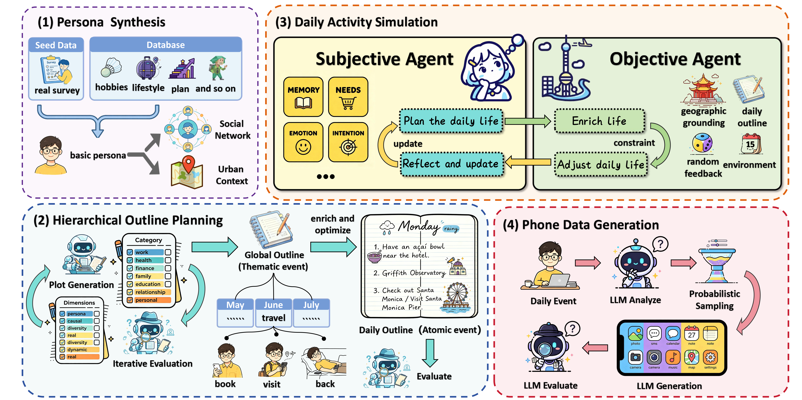
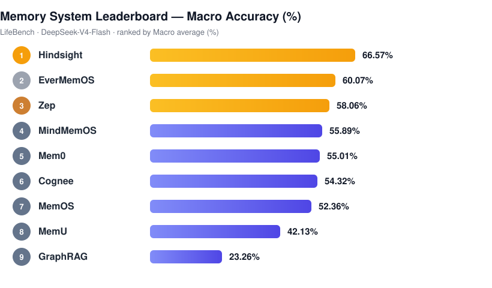

<div align="center">

# LifeBench

**A Benchmark for Long-Horizon Multi-Source Memory**

Connected life histories and digital traces for evaluating personalized agent memory.

[](https://huggingface.co/datasets/C1754955896/Lifebenchv2.0)
[](https://arxiv.org/abs/2603.03781)
[](https://huggingface.co/spaces/C1754955896/Lifebench-Leaderboard)
[](LICENSE)

**10 Users ? 1 Year ? 57,486 Events ? 47,409 Phone Records ? 3,380 QA Pairs**

[Dataset](#dataset) ? [Evaluation](#evaluation) ? [Data Generation](#data-generation) ? [Data Viewer](#data-viewer) ? [Documentation](#documentation)

</div>

## Start Here

| I want to? | Start here |
|------------|------------|
| Use the released dataset | [Download on Hugging Face](https://huggingface.co/datasets/C1754955896/Lifebenchv2.0) or browse the [local data](life_bench_data/version2/) |
| Evaluate a memory agent | [LifeBench_eval](https://github.com/1754955896/LifeBench_eval) |
| Generate new life histories and QA | [Installation](docs/installation.md) and [generation guide](docs/generation.md) |
| Explore a user's events and phone records | [Local data viewer](apps/viewer/README.md) |

## Overview

LifeBench combines a life event simulator with a benchmark for personalized agent memory. The pipeline expands a persona into connected plans, daily activities, phone records, and questions with supporting evidence and scoring points.



*Persona preparation ? daily planning ? life simulation ? digital traces ? evidence-based QA.* [Full-resolution diagram](docs/assets/synthesis_framework.png).

## Dataset

The released **LifeBench v2.0** contains synthetic life histories for 10 virtual users throughout 2025, in Chinese and English.

| Statistic | Value |
|-----------|-------|
| Virtual users | 10 |
| Time span | January 1 to December 31, 2025 |
| Languages | Chinese and English |
| Daily life events | 57,486 |
| Phone records | 47,409 |
| Phone data sources | 9 |
| Question-answer pairs | 3,380 |
| Question categories | 9 |

Counts are for **one language version**. Translations and LoCoMo exports represent the same histories and questions and are not counted as additional samples.

| Representation | Local path |
|----------------|------------|
| Chinese multi-source data | [life_bench_data/version2/data/](life_bench_data/version2/data/) |
| English multi-source data | [life_bench_data/version2/data_en/](life_bench_data/version2/data_en/) |
| Chinese and English LoCoMo conversations | [life_bench_data/version2/locomo_format/](life_bench_data/version2/locomo_format/) |

Each user directory includes a persona, daily drafts and events, an event tree, nine phone data files, and `QA_all/QA.json`. Phone sources cover assistant conversations, calendar, calls, contacts, health, notes, photos, notifications, and SMS.

Reading the released JSON files requires no generation APIs or embedding model. See the [dataset guide](life_bench_data/README.md) and [format reference](life_bench_data/version2/README.md).

## Evaluation

Use **[LifeBench_eval](https://github.com/1754955896/LifeBench_eval)** to evaluate memory agents on the existing dataset.



*Macro accuracy across nine question categories with DeepSeek-V4-Flash.* Explore all base models and per-category results in the **[interactive leaderboard](https://huggingface.co/spaces/C1754955896/Lifebench-Leaderboard)** or the [dataset results table](life_bench_data/version2/README.md#-leaderboard).

Question categories cover single-hop, multi-hop, temporal reasoning, pattern recognition, knowledge update, causal reasoning, conflict detection, hidden information, and unanswerable questions. Gold Evidence supplies supporting evidence directly to the answer model as a perfect-retrieval reference.

## Data Generation

Run from a cloned repository with Python 3.10 or 3.11. Complete [installation and provider configuration](docs/installation.md) first; generation uses the configured LLM and map services.

### Generate a life history

Create a working directory and copy a complete sample persona:

```bash
python -c "from pathlib import Path; Path('output/fenghaoran').mkdir(parents=True, exist_ok=True)"
python -c "from shutil import copyfile; copyfile('life_bench_data/version2/data/fenghaoran/persona.json', 'output/fenghaoran/persona.json')"
python scripts/run.py --base-path output/fenghaoran --year 2025 --months 12
```

The pipeline produces daily events, phone records, and QA in the selected directory. See the [generation guide](docs/generation.md) for new persona generation and batch runs, and the [argument reference](docs/configuration.md) for available options.

### Generate QA from existing data

Point the standalone script to a generated user directory:

```bash
python scripts/run/qa_gen.py --data-path output/fenghaoran
```

The directory should contain `persona.json`, `daily_draft.json`, `daily_event.json`, `event_tree.json`, and `phone_data/`; retain the accompanying `process/` directory. The default year is 2025; pass `--year` for another year. Final questions are written to `QA_all/QA.json`, with additional phone evidence in `phone_data/new/`. Use these outputs together.

## Data Viewer

Open **[apps/viewer/index.html](apps/viewer/index.html)** locally in Chrome or Edge, then select a user directory containing `daily_event.json`. Browse the calendar, search events, and inspect linked phone records. Files are read locally; no backend or build step is required. See the [viewer guide](apps/viewer/README.md).

## Documentation

| Guide | Contents |
|-------|----------|
| [Installation](docs/installation.md) | Python environment, embedding model, and provider setup |
| [Data generation](docs/generation.md) | Simulation, persona generation, QA, and batch commands |
| [Generation arguments](docs/configuration.md) | Simulation and persona CLI parameters |
| [Runtime configuration](config/README.md) | LLM, map, and simulation configuration |
| [Dataset reference](life_bench_data/version2/README.md) | Record formats, statistics, and benchmark results |
| [Source modules](src/lifebench/README.md) | Implementation structure |
| [Contributing](CONTRIBUTING.md) | Development and documentation changes |

## Citation and License

If you use LifeBench in research, cite the **[LifeBench paper](https://arxiv.org/abs/2603.03781)** and **[LifeBench v2.0 dataset](https://huggingface.co/datasets/C1754955896/Lifebenchv2.0)**.

LifeBench is released under the [Apache License 2.0](LICENSE).
